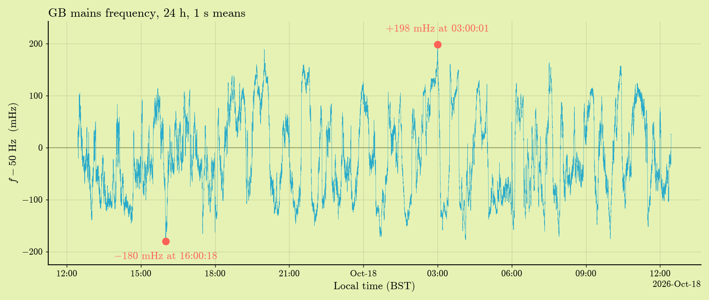
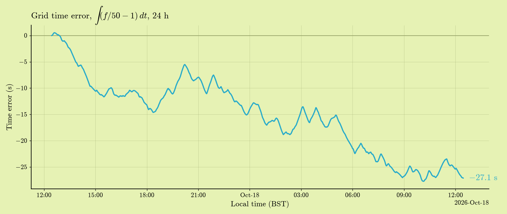
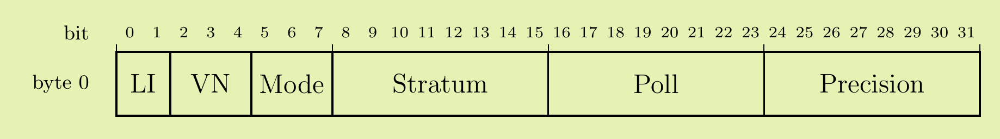
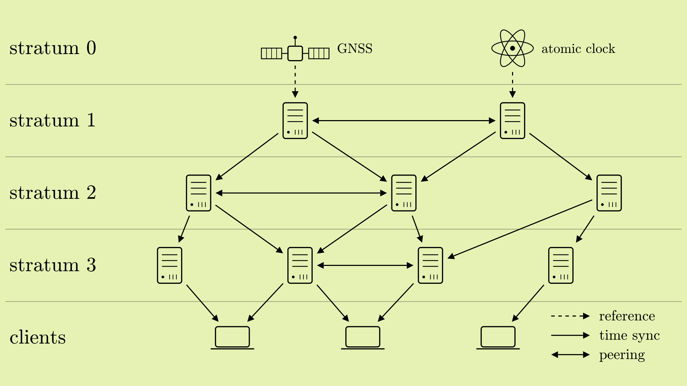
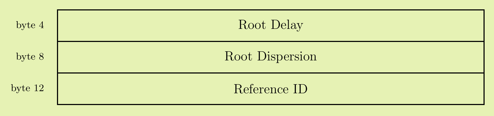
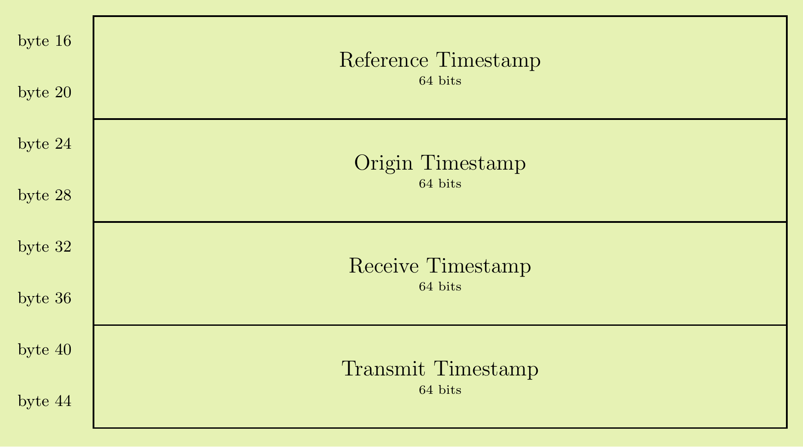

## Background
What is a clock? It's a repetitive phenomenon with a counting device. The repetitive phenomenon could be the earth's rotation, a swinging pendulum, or an oscillating crystal. Their respective counting devices are the ticks on a sundial, escapement on a mechanical clock, and binary divider on a digital watch.

Early computers did not have precise internal oscillators, instead relying directly on the power grid's 50Hz or 60Hz AC frequency as a precise timing source to trigger hardware interrupts. These were called Line Time Clocks, with the PDP-11 being a legendary example. While an ingenious early solution, grid frequency can swing by more than 0.2Hz daily causing any clock to lose several seconds of accuracy. 

To check this accuracy myself I connected my oscilloscope to mains power and measured the frequency over a 24 hour period. I expected to see some of the largest swings happening as grid demand grew in the evenings but instead, we see the largest changes happening consistently at the top of the hour. I would need several more days of data before I could draw any conclusions.



Being based on the grid's line frequency did have its benefits. Computers located on the same grid would share the same frequency offsets, and would only need to sync their counting devices. Below we see that a clock based on the grid's line frequency would have lost 27.1s in a single day. Not great. 


The move to independent crystal oscillators brought an order of magnitude greater precision to computers, however, any protocol now needed to correct for intrinsic frequency variation of quartz oscillators. This could be up to several hundred PPM. 

In 1985, David Mills of the University of Delaware (Roll Hens!) introduced NTPv0. This included the main algorithm that is still used to this day to compute offset/delay between client and server.

## Algorithm
For just a moment, imagine yourself to be a Tudor era trading merchant, you have a meeting with an impatient ship captain at *precisely* high noon, but your table clock has stopped. You wind it up, but aren't sure exactly what time to set it to. No problem, there's a large clock in town square. But by the time you run there and back who knows how far off you could be! Again, this is no problem, you're a trading merchant with a hobby in precision metrology. 

You note down the time it says on your table clock when you leave $T_1$ and run as fast as you can to the square. As soon as you arrive, you mark the time it says at the church $T_2$, catch your breath, mark the time again right as you leave $T_3$, and run as fast as you can back home making a final observation of your table clock's current time $T_4$. Can we use these four results to properly set our table clock? 

Let's think about it. How long did it take to get from home, to the square and back? We made note of the time on the table clock when we left ($T_1$) and when we returned ($T_4$). Their difference ($T_4 - T_1$), also accounting for the time we took to catch our breath ($T_3 - T_2$), is the round trip time! We'll call this quantity delta. $\delta = (T_4 - T_1) - (T_3 - T_2)$

Progress...but we still don't know the offset between the two clocks, how might we surmise this? We know we left at $T_1$, and it took $\delta /2$ to get there. This should equal the time we get once we arrive $T_2$ minus whatever offset we're trying to find ($\theta$). We have only one unknown variable now! Solving our equation $T_1 + \delta / 2 = T_2 - \theta$ gives us our offset! You're now safe in knowing you'll make it to your rendezvous on time, and hopefully a bit pleased to be the first person to implement NTP by several hundred years. 

Below are our two equations, written in terms of only the timestamps. There may be a few problems you can spot. One being that we're assuming our path delay $\delta$ is symmetric. Another being that any frequency offset will continue to accumulate.

$$\theta = \frac{(T_2 - T_1) + (T_3 - T_4)}{2}, \qquad \delta = (T_4 - T_1) - (T_3 - T_2)$$


<div id="ntp-lab-host"></div>

<script>
// Merchant clock simulator: offset and delay from the four timestamps.
(() => {
// The merchant's table clock (home) vs the church clock (town square).
// T1 leave home (table) → T2 arrive square (church) → T3 leave square (church) → T4 arrive home (table)
const root = document.createElement('div');
root.className = 'ntp-lab';
document.getElementById('ntp-lab-host').appendChild(root);
root.innerHTML = `
<style>
/* Same palette as the post's figures: cream paper, black ink, cyan / orange / pink accents. */
.ntp-lab{--paper:#e6f2b4;--ink:#000000;--home:#00bfbc;--church:#ec7500;--hand:#d53984}
.ntp-lab canvas{display:block;width:100%;aspect-ratio:1.6/1;background:var(--paper)}
.ntp-lab .read{display:flex;justify-content:space-between;flex-wrap:wrap;gap:4px 16px;margin-top:4px}
.ntp-lab .row{display:grid;grid-template-columns:1fr 1fr;gap:12px;align-items:end;margin-top:8px}
.ntp-lab .btns{display:flex;flex-wrap:wrap;gap:8px;margin-top:10px}
@media (max-width:600px){.ntp-lab .row{grid-template-columns:1fr}}
.ntp-lab .ctl{display:grid;gap:2px}
.ntp-lab .ctl span{display:flex;justify-content:space-between;gap:8px}
.ntp-lab output,.ntp-lab .mono{font-family:var(--font-monospace,ui-monospace,Menlo,Consolas,monospace);font-variant-numeric:tabular-nums}
.ntp-lab input[type=range]{width:100%}
.ntp-lab table{width:100%;margin-top:10px}
.ntp-lab td:last-child{text-align:right;font-family:var(--font-monospace,ui-monospace,Menlo,Consolas,monospace)}
.ntp-lab .h{color:var(--home)} .ntp-lab .c{color:var(--church)}
.ntp-lab .res{margin-top:8px;white-space:pre-wrap}
</style>
<canvas></canvas>
<div class="read mono"><span><span class="h">Table clock</span> <span data-r="table"></span></span><span><span class="c">Church clock</span> <span data-r="church"></span></span></div>
<div class="row">
  <label class="ctl"><span>Table clock set wrong by <output data-o="off"></output></span>
    <input type="range" data-i="off" min="-30" max="30" step="1" value="-12"></label>
  <label class="ctl"><span>Table clock runs <output data-o="drift"></output></span>
    <input type="range" data-i="drift" min="-10" max="10" step="0.5" value="0"></label>
</div>
<div class="btns">
  <button class="mod-cta" data-b="run">Run to the square</button>
  <button data-b="set" disabled>Set the table clock</button>
</div>
<table><tbody>
  <tr><td><span class="h">T₁</span> leave home · read the table clock</td><td data-t="0">—</td></tr>
  <tr><td><span class="c">T₂</span> arrive at the square · read the church clock</td><td data-t="1">—</td></tr>
  <tr><td><span class="c">T₃</span> breath caught, leave · read the church clock</td><td data-t="2">—</td></tr>
  <tr><td><span class="h">T₄</span> back home · read the table clock</td><td data-t="3">—</td></tr>
</tbody></table>
<div class="res mono">Your table clock has stopped and you've wound it up. Run to the square to find out what it should say.</div>`;

const q = s => root.querySelector(s);
const cv = q('canvas'), g = cv.getContext('2d'), res = q('.res');
const runBtn = q('[data-b="run"]'), setBtn = q('[data-b="set"]');
const offIn = q('[data-i="off"]'), driftIn = q('[data-i="drift"]');
const MINUS = '−', MONO = 'ui-monospace, Menlo, Consolas, monospace';
const RUN = 1.5, BREATH = 0.8;          // seconds each way, seconds catching breath
const now = () => performance.now() / 1000;
const d0 = new Date(), N0 = d0.getHours()*3600 + d0.getMinutes()*60 + d0.getSeconds() + d0.getMilliseconds()/1000, P0 = now();
const church = t => N0 + (t - P0);      // the town clock is the reference
let tBase = 0, tAt = 0, rate = 1, trip = null, theta = null;
const table = t => tBase + (t - tAt) * rate;
const sgn = (v, d) => (v < 0 ? MINUS : '+') + Math.abs(v).toFixed(d);
const hms = x => { x = ((x % 86400) + 86400) % 86400; const h = Math.floor(x/3600), m = Math.floor(x/60) % 60, s = x % 60;
  return String(h).padStart(2,'0') + ':' + String(m).padStart(2,'0') + ':' + s.toFixed(3).padStart(6,'0'); };
const C = k => getComputedStyle(root).getPropertyValue(k).trim();

function labels() {
  q('[data-o="off"]').textContent = sgn(+offIn.value, 0) + ' s';
  const d = +driftIn.value;
  q('[data-o="drift"]').textContent = d === 0 ? 'true' : Math.abs(d).toFixed(1) + ' % ' + (d > 0 ? 'fast' : 'slow');
}
function setWrong() { const t = now(); tBase = church(t) + +offIn.value; tAt = t; }
function setRate()  { const t = now(); tBase = table(t); tAt = t; rate = 1 + +driftIn.value / 100; }
offIn.addEventListener('input', () => { labels(); setWrong(); });
driftIn.addEventListener('input', () => { labels(); setRate(); });

const cell = i => q(`[data-t="${i}"]`);
runBtn.addEventListener('click', () => {
  const t = now(); trip = { start: t, T: [table(t)] };
  cell(0).textContent = hms(trip.T[0]); [1,2,3].forEach(i => cell(i).textContent = '…');
  res.textContent = 'Running to the square…'; runBtn.disabled = true; setBtn.disabled = true;
});
function tickTrip(t) {
  if (!trip || trip.done) return;
  const e = t - trip.start;
  if (trip.T.length === 1 && e >= RUN)            { trip.T.push(church(trip.start + RUN));            cell(1).textContent = hms(trip.T[1]); res.textContent = 'Catching your breath…'; }
  if (trip.T.length === 2 && e >= RUN + BREATH)   { trip.T.push(church(trip.start + RUN + BREATH));   cell(2).textContent = hms(trip.T[2]); res.textContent = 'Running home…'; }
  if (trip.T.length === 3 && e >= 2*RUN + BREATH) { trip.T.push(table(trip.start + 2*RUN + BREATH));  cell(3).textContent = hms(trip.T[3]); finish(); }
}
function finish() {
  const [T1, T2, T3, T4] = trip.T, f = v => v.toFixed(3);
  const delta = (T4 - T1) - (T3 - T2);   // round trip, minus the time spent catching breath
  theta = T2 - T1 - delta / 2;          // from T1 + δ/2 = T2 − θ
  res.textContent =
    `Round trip:  δ = (T₄ − T₁) − (T₃ − T₂) = ${f(T4-T1)} − ${f(T3-T2)} = ${f(delta)} s\n` +
    `Half of it to get there:  T₁ + δ/2 = T₂ − θ\n` +
    `           θ = T₂ − T₁ − δ/2 = ${f(T2-T1)} − ${f(delta/2)} = ${sgn(theta,3)} s\n` +
    `The church clock is ${Math.abs(theta).toFixed(3)} s ${theta >= 0 ? 'ahead of' : 'behind'} your table clock.`;
  trip.done = now(); runBtn.disabled = false; setBtn.disabled = false;
}
setBtn.addEventListener('click', () => {
  const t = now(); tBase = table(t) + theta; tAt = t;   // move the hands by θ
  const left = church(t) - table(t);
  res.textContent += `\n\nTable clock moved ${sgn(theta,3)} s. It is now off by ${sgn(left,3)} s` +
    (Math.abs(+driftIn.value) > 0 ? ' and will drift again, because it still runs ' + (rate > 1 ? 'fast.' : 'slow.') : '.');
  setBtn.disabled = true; theta = null;
});

// Objects keep their own colours (wood, brass, stone); the ink and the second hand come from the palette above.
const WOOD = '#6b3f22', WOOD_D = '#442612', TABLE = '#7d4e2c', BRASS = '#c9a14a', DIAL = '#f3ead2',
      INK = C('--ink'), RED = C('--hand'), STONE = '#a29d93', STONE_D = '#7b766d', ROOF = '#4f5a63', DOOR = '#4e3220';
const ROMAN = ['XII','I','II','III','IIII','V','VI','VII','VIII','IX','X','XI'];
const circle = (x, y, r) => { g.beginPath(); g.arc(x, y, r, 0, Math.PI*2); };

function dial(cx, cy, r, time) {
  g.fillStyle = BRASS; circle(cx, cy, r*1.08); g.fill();
  g.fillStyle = DIAL;  circle(cx, cy, r); g.fill();
  g.strokeStyle = INK; g.lineWidth = Math.max(0.8, r*0.015);
  circle(cx, cy, r*0.95); g.stroke(); circle(cx, cy, r*0.86); g.stroke();
  for (let i = 0; i < 60; i++) {
    const a = i/60*Math.PI*2, r1 = i % 5 === 0 ? 0.86 : 0.9;
    g.lineWidth = i % 5 === 0 ? Math.max(1.2, r*0.03) : Math.max(0.6, r*0.01);
    g.beginPath(); g.moveTo(cx + Math.sin(a)*r*r1, cy - Math.cos(a)*r*r1); g.lineTo(cx + Math.sin(a)*r*0.95, cy - Math.cos(a)*r*0.95); g.stroke();
  }
  if (r > 26) {
    g.fillStyle = INK; g.font = `${Math.max(6, r*0.15)}px Georgia, "Times New Roman", serif`;
    g.textAlign = 'center'; g.textBaseline = 'middle';
    ROMAN.forEach((n, i) => { const a = i/12*Math.PI*2; g.fillText(n, cx + Math.sin(a)*r*0.68, cy - Math.cos(a)*r*0.68); });
    g.textBaseline = 'alphabetic';
  }
  const x = ((time % 43200) + 43200) % 43200, s = x % 60, m = (x/60) % 60, h = x/3600;
  const hand = (frac, len, w, c) => { const a = frac*Math.PI*2; g.strokeStyle = c; g.lineWidth = w; g.lineCap = 'round';
    g.beginPath(); g.moveTo(cx - Math.sin(a)*r*0.12, cy + Math.cos(a)*r*0.12); g.lineTo(cx + Math.sin(a)*r*len, cy - Math.cos(a)*r*len); g.stroke(); };
  hand(h/12, 0.48, r*0.07, INK); hand(m/60, 0.8, r*0.045, INK); hand(s/60, 0.88, Math.max(1, r*0.018), RED);
  g.fillStyle = BRASS; circle(cx, cy, r*0.06); g.fill();
}

// Bracket clock: arched wooden case, brass handle, pendulum window, little feet.
function tableClock(cx, base, r, time) {
  const w = 1.25*r, top = base - 2.7*r;
  g.fillStyle = WOOD_D;
  g.fillRect(cx - w - 0.02*r, base - 0.18*r, 0.35*r, 0.18*r); g.fillRect(cx + w - 0.33*r, base - 0.18*r, 0.35*r, 0.18*r);
  g.strokeStyle = BRASS; g.lineWidth = r*0.07; g.lineCap = 'round';
  g.beginPath(); g.arc(cx, top - w, 0.35*r, Math.PI, 0); g.stroke();
  g.fillStyle = WOOD; g.strokeStyle = WOOD_D; g.lineWidth = 2;
  g.beginPath(); g.moveTo(cx - w, base - 0.15*r); g.lineTo(cx - w, top); g.arc(cx, top, w, Math.PI, 0); g.lineTo(cx + w, base - 0.15*r); g.closePath(); g.fill(); g.stroke();
  g.fillStyle = WOOD_D; g.fillRect(cx - w - 0.08*r, base - 0.4*r, 2*w + 0.16*r, 0.25*r);
  // pendulum window: a seconds pendulum (2 s period) beating with the table clock's own time
  const wx = cx - 0.45*r, wy = top + 1.22*r, ww = 0.9*r, wh = 0.75*r;
  g.fillStyle = '#21140b'; g.fillRect(wx, wy, ww, wh);
  g.save(); g.beginPath(); g.rect(wx, wy, ww, wh); g.clip();
  const sw = Math.sin(Math.PI * time) * 0.3, L = 0.55*r;
  const bx = cx + Math.sin(sw)*L, by = wy + Math.cos(sw)*L;
  g.strokeStyle = BRASS; g.lineWidth = Math.max(1, r*0.025); g.beginPath(); g.moveTo(cx, wy); g.lineTo(bx, by); g.stroke();
  g.fillStyle = BRASS; circle(bx, by, r*0.11); g.fill();
  g.restore();
  g.strokeStyle = BRASS; g.lineWidth = Math.max(1, r*0.03); g.strokeRect(wx, wy, ww, wh);
  dial(cx, top, r*0.95, time);
}

// Church tower: stone courses, arched door and slit window, eaves, slate spire and cross.
function churchClock(cx, ground, r, time) {
  const tw = 1.4*r, tTop = ground - 4.6*r;
  g.fillStyle = STONE; g.fillRect(cx - tw, tTop, 2*tw, ground - tTop);
  g.strokeStyle = STONE_D; g.lineWidth = 1; g.globalAlpha = 0.5;
  for (let y = ground - 0.45*r, k = 0; y > tTop; y -= 0.45*r, k++) {
    g.beginPath(); g.moveTo(cx - tw, y); g.lineTo(cx + tw, y); g.stroke();
    for (let x = cx - tw + (k % 2 ? 0.35*r : 0.7*r); x < cx + tw; x += 0.7*r) { g.beginPath(); g.moveTo(x, y); g.lineTo(x, y + 0.45*r); g.stroke(); }
  }
  g.globalAlpha = 1; g.strokeStyle = STONE_D; g.lineWidth = 2; g.strokeRect(cx - tw, tTop, 2*tw, ground - tTop);
  const arched = (x, bottom, hw, h, col) => { g.fillStyle = col; g.beginPath(); g.moveTo(x - hw, bottom); g.lineTo(x - hw, bottom - h + hw);
    g.arc(x, bottom - h + hw, hw, Math.PI, 0); g.lineTo(x + hw, bottom); g.closePath(); g.fill(); };
  arched(cx, ground, 0.4*r, 1.3*r, DOOR);
  arched(cx, ground - 1.7*r, 0.12*r, 0.55*r, '#2c2a27');
  g.fillStyle = ROOF; g.beginPath(); g.moveTo(cx - tw - 0.1*r, tTop); g.lineTo(cx + tw + 0.1*r, tTop); g.lineTo(cx, tTop - 1.9*r); g.closePath(); g.fill();
  g.fillStyle = STONE_D; g.fillRect(cx - tw - 0.14*r, tTop - 0.08*r, 2*tw + 0.28*r, 0.2*r);
  g.strokeStyle = BRASS; g.lineWidth = Math.max(1.5, r*0.06); g.lineCap = 'butt';
  g.beginPath(); g.moveTo(cx, tTop - 1.9*r); g.lineTo(cx, tTop - 2.35*r); g.moveTo(cx - 0.14*r, tTop - 2.18*r); g.lineTo(cx + 0.14*r, tTop - 2.18*r); g.stroke();
  dial(cx, ground - 3.45*r, 0.95*r, time);
}

const readT = q('[data-r="table"]'), readC = q('[data-r="church"]');
function draw() {
  if (!root.isConnected) return; // note closed or re-rendered: stop the loop
  const t = now(); tickTrip(t);
  readT.textContent = hms(table(t)); readC.textContent = hms(church(t));
  const w = cv.clientWidth, h = cv.clientHeight, dpr = window.devicePixelRatio || 1;
  if (w && h) {
    if (cv.width !== Math.round(w*dpr) || cv.height !== Math.round(h*dpr)) { cv.width = Math.round(w*dpr); cv.height = Math.round(h*dpr); }
    g.setTransform(dpr, 0, 0, dpr, 0, 0);
    g.fillStyle = C('--paper'); g.fillRect(0, 0, w, h);   // cream paper, like the figures
    const ground = h*0.94, rC = Math.min(h*0.13, w*0.085), rT = rC*0.8;
    const cxT = w*0.2, cxC = w*0.8, tableTop = ground - 1.9*rC;
    // ground and table
    g.strokeStyle = C('--ink'); g.lineWidth = 2;
    g.beginPath(); g.moveTo(0, ground); g.lineTo(w, ground); g.stroke();
    g.fillStyle = TABLE;
    g.fillRect(cxT - 2*rC, tableTop, 4*rC, 0.16*rC);
    g.fillRect(cxT - 1.8*rC, tableTop, 0.14*rC, ground - tableTop); g.fillRect(cxT + 1.66*rC, tableTop, 0.14*rC, ground - tableTop);
    tableClock(cxT, tableTop, rT, table(t));
    churchClock(cxC, ground, rC, church(t));
    // the road between home and the square, in ghost ink
    const x0 = cxT + 2*rC + 8, x1 = cxC - 1.4*rC - 8, yOut = ground - 0.75*rC, yBack = ground - 0.25*rC;
    g.strokeStyle = C('--ink'); g.globalAlpha = 0.35; g.lineWidth = 1; g.setLineDash([4, 5]);
    g.beginPath(); g.moveTo(x0, yOut); g.lineTo(x1, yOut); g.moveTo(x0, yBack); g.lineTo(x1, yBack); g.stroke();
    g.setLineDash([]); g.globalAlpha = 1;
    if (trip && !(trip.done && t - trip.done > 0.6)) {
      const e = t - trip.start; let x, y, lab;
      if (e < RUN)               { x = x0 + (x1 - x0)*e/RUN; y = yOut; lab = 'T₁'; }
      else if (e < RUN + BREATH) { x = x1; y = (yOut + yBack)/2; lab = 'T₁ T₂'; }
      else { const k = Math.min(1, (e - RUN - BREATH)/RUN); x = x1 - (x1 - x0)*k; y = yBack; lab = 'T₁ T₂ T₃'; }
      const hat = Math.max(18, rC*0.55);
      g.textAlign = 'center'; g.textBaseline = 'middle';
      g.font = `${hat}px "Apple Color Emoji","Segoe UI Emoji","Noto Color Emoji",sans-serif`;
      g.fillText('🎩', x, y - hat*0.35);
      g.textBaseline = 'alphabetic'; g.fillStyle = C('--ink'); g.font = `${Math.max(10, rC*0.22)}px ${MONO}`;
      g.fillText(lab, x, y - hat*0.95);
    }
  }
  requestAnimationFrame(draw);
}
labels(); setWrong(); setRate(); requestAnimationFrame(draw);

})();
</script>


As of today we're on NTPv4. Over the years we've seen the introduction of clock filters (v1), authentication (v2) and error budget analysis (v3), arriving at the standard we recognize today.

## NTP packet structure
Let's analyze the structure of a NTPv4 packet and see what we might be able to learn.



Starting with the first byte, we have a **leap indicator** (more on this later), **version number** (almost always 4), and **mode** (3 for client, 4 for server).

Our next byte, **Stratum**, is valid between 0 - 16 and indicates the *distance* from a reference clock. Stratum 0 is the reference itself (GNSS, an atomic clock), and a server attached directly to one is stratum 1. In the packet, 0 never means a reference: it means *unspecified*, which is what a client sends in its request (as we'll see in the captures below). While in practice you can have up to 15 layers, it's uncommon to see references further than 3-4 steps away. A stratum of 16 is reserved for unsynchronized clocks which should not be used.




Our third byte **poll** is how often syncs are done in $\log_2(\text{seconds})$. Typically clients will start at 6 (64s) and progressively back off towards 10 (1024s) as the client stabilizes. This can also be set to a negative value, for example -6 (15.6ms), but now we're starting to get into PTP territory.

Our last byte **precision** ($\rho$) is the resolution of the sender's system clock. It's measured by the system on startup by taking sequential system clock reads to find the minimum step between reads. Older kernels can live in the microsecond range, while modern Linux systems typically report −23 to −26 (15–120 ns). Google's servers, as we'll see shortly, report a conservative −20 (~1 µs). 



**Root Delay** is the total round trip time it takes to get from the reference clock to the current server. 

**Root Dispersion** is a worst case error bound of your current source. It shows you the potential worst case accumulated error from the reference clock. For a single jump, this is server precision + client precision + clock skew (frequency variation). 
$$\varepsilon = 2^{\rho_{\text server}} + 2^{\rho_{\text client}} + \phi\,(T_4 - T_1)$$
For every additional server in the chain away from the reference clock, you add these together. For a client communicating with a stratum 3 server:
$$\varepsilon_{\text client} = \varepsilon_0+\varepsilon_1+\varepsilon_2+\varepsilon_3$$


**Reference ID** is another mechanism to determine the server you're communicating with. For stratum 0 and 1 servers, this typically describes the type of source for example, GPS for GNSS sync or WWV for radio sync, inside the US. 

For stratum 2 and higher, Reference ID encodes the upstream server's IP address to prevent loopbacks where two servers are syncing off of each other.




Here are three of the four timestamps we know and love: Origin ($T_1$), Receive ($T_2$) and Transmit ($T_3$). $T_4$ is noted by the client on receipt and never goes on the wire. The Reference Timestamp is something else: it's when the sender last disciplined its own clock. They're all 32.32 fixed point seconds since 1900-01-01. Subtract 2 208 988 800 to get the Unix epoch.

Let's get out of theory land and start doing some fun stuff. 

## NTP in practice

We can use `tcpdump` to view the NTP packets as they arrive and are sent on our system. All NTP traffic is done over port 123. 

```
sudo tcpdump -n -vvv -i any udp port 123
```

With tcpdump listening on port 123, we can send our own ntp request with `sntp`.
```
$ sntp time.google.com                           
+0.002253 +/- 0.011982 time.google.com 216.239.35.0
```

Here are our NTP packets in the flesh, or rather a snippet of one send and receive. Our command generated 5 total requests which are then used to better estimate path delay. If our computer's network card had been in standby mode, the time to wake it up, reconnect to wifi, send and receive a packet does not accurately reflect the path delay normally seen. With 5 total requests, we can ignore these outliers.

```
13:50:37.929536 IP (tos 0x0, ttl 64, id 39444, offset 0, flags [none], proto UDP (17), length 76)
    10.3.230.180.57328 > 216.239.35.8.123: [udp sum ok] NTPv4, Client, length 48
        Leap indicator:  (0), Stratum 0 (unspecified), poll 0 (1s), precision 0
        Root Delay: 0.000000, Root dispersion: 0.000000, Reference-ID: (unspec)
          Reference Timestamp:  0.000000000
          Originator Timestamp: 0.000000000
          Receive Timestamp:    0.000000000
          Transmit Timestamp:   4001403037.929489999 (2026-10-19T12:50:37Z)
            Originator - Receive Timestamp:  0.000000000
            Originator - Transmit Timestamp: 4001403037.929489999 (2026-10-19T12:50:37Z)
13:50:37.940106 IP (tos 0x0, ttl 101, id 13274, offset 0, flags [none], proto UDP (17), length 76)
    216.239.35.8.123 > 10.3.230.180.57328: [udp sum ok] NTPv4, Server, length 48
        Leap indicator:  (0), Stratum 1 (primary reference), poll 0 (1s), precision -20
        Root Delay: 0.000000, Root dispersion: 0.000091, Reference-ID: GOOG
          Reference Timestamp:  4001403037.937357777 (2026-10-19T12:50:37Z)
          Originator Timestamp: 4001403037.929489999 (2026-10-19T12:50:37Z)
          Receive Timestamp:    4001403037.937357777 (2026-10-19T12:50:37Z)
          Transmit Timestamp:   4001403037.937357778 (2026-10-19T12:50:37Z)
            Originator - Receive Timestamp:  +0.007867778
            Originator - Transmit Timestamp: +0.007867778
```
> [!info]+ Decoding
> - **Byte 0** Mode: 3 = client, 4 = server.
> - **Poll / Precision** are signed log₂ seconds: $2^{\text{value}}$ s. Server precision −20 → $2^{-20} \approx 954$ ns.
> - **Root Delay / Dispersion** The server’s root delay is 0 s, as you’d expect at stratum 1. Its root dispersion is `0x00000006`, so $6/65536 = 91.55\,\mu\text{s}$, which tcpdump truncates to 0.000091.
> - **Reference ID** Google uses their own RefID `GOOG`; unofficial, but it shows how it can be anything you want.

Using just `sudo tcpdump -n udp port 123` we can more easily see the 5 pairs of our exchange.
```
14:10:54.126505 IP 10.3.230.180.56335 > 216.239.35.8.123: NTPv4, Client
14:10:54.139580 IP 216.239.35.8.123 > 10.3.230.180.56335: NTPv4, Server
14:10:54.141768 IP 10.3.230.180.58776 > 216.239.35.4.123: NTPv4, Client
14:10:54.153588 IP 216.239.35.4.123 > 10.3.230.180.58776: NTPv4, Server
14:10:54.155450 IP 10.3.230.180.62451 > 216.239.35.0.123: NTPv4, Client
14:10:54.167908 IP 216.239.35.0.123 > 10.3.230.180.62451: NTPv4, Server
14:10:54.169781 IP 10.3.230.180.61605 > 216.239.35.0.123: NTPv4, Client
14:10:54.184450 IP 216.239.35.0.123 > 10.3.230.180.61605: NTPv4, Server
14:10:54.186431 IP 10.3.230.180.51821 > 216.239.35.12.123: NTPv4, Client
14:10:54.199382 IP 216.239.35.12.123 > 10.3.230.180.51821: NTPv4, Server
```

Notice how even though we queried time.google.com, we got responses from multiple different servers? Google, and many other providers use a DNS round-robin to distribute load and vote out bad servers.

| IP            | Hostname                         |
| ------------- | -------------------------------- |
| 216.239.35.0  | time1.google.com (queried twice) |
| 216.239.35.4  | time2.google.com                 |
| 216.239.35.8  | time3.google.com                 |
| 216.239.35.12 | time4.google.com                 |

| Host                | A records returned | Mechanism                                                                                  |
| ------------------- | ------------------ | ------------------------------------------------------------------------------------------ |
| time.google.com     | 4                  | Round-robin **plus** anycast on every IP                                                   |
| time.cloudflare.com | 2                  | Round-robin of 2, both anycast                                                             |
| time.apple.com      | 3                  | Round-robin within a **geo-DNS** answer: you get servers near your resolver                |
| time.aws.com        | 5                  | Round-robin within a geo-DNS answer. These look regional (us-east), not anycast            |
| time.windows.com    | 1                  | **No round-robin.** Azure Traffic Manager-style DNS steering hands out one IP per response |
| time.facebook.com   | 1                  | **No round-robin.** One anycast IP does all the work                                       |

## NTP pool
To me, the NTP Pool project is the pinnacle of what a community run public infrastructure project looks like. Since 2003, a team of volunteers has been maintaining a DNS load balanced cluster of public NTP servers. `pool.ntp.org` will return a reasonable NTP time from anywhere in the world, and is distributed enough to be nearly impossible to interrupt. Because of this, many vendors ship the NTP pool as their main timeserver configuration. Modern internet infrastructure is built from the selfless volunteers doing it for the love of the game.

Let's see what servers we get from the pool.
```
$ for ip in $(dig +short uk.pool.ntp.org); do echo "== $ip"; dig +short -x $ip; done
== 131.111.8.60
pool.ntp0.cam.ac.uk.
== 139.143.5.31
ntpsvr2.npl.co.uk.
== 45.138.55.60
leontp1.office.panq.nl.
== 178.62.18.76
slideaway.preshweb.co.uk.
```

We've got an interesting list of time servers here.

- **pool.ntp0.cam.ac.uk** - This is University of Cambridge’s public server. Stratum 2, so one hop from a GNSS reference.
- **ntpsvr2.npl.co.uk** - This is the UK's National Physical Laboratory, home of UTC(NPL), the UK’s national realization of UTC, steered by NPL's caesium fountains. The box answering us is a Meinberg (that `MBGh` refID) fed from it. It doesn't get better than this. 
- **leontp1.office.panq.nl** - Someone in the Panq office is running a little LeoNTP GPS synchronized timeserver. Very cool appliance for only a few hundred bucks! 
- **slideaway.preshweb.co.uk** - Is a DigitalOcean VPS, run by a hobbyist. This is a VM clock, so will almost certainly have the most jitter. (David looks like a real OG.)

I may have queried the pool a few times to get an interesting spread, but this is the pool in a nutshell. I've added these servers directly to my chrony configuration. Let's see how it chooses which servers to use.

```
$ chronyc sources -v

  .-- Source mode  '^' = server, '=' = peer, '#' = local clock.
 / .- Source state '*' = current best, '+' = combined, '-' = not combined,
| /             'x' = may be in error, '~' = too variable, '?' = unusable.
||                                                 .- xxxx [ yyyy ] +/- zzzz
||      Reachability register (octal) -.           |  xxxx = adjusted offset,
||      Log2(Polling interval) --.      |          |  yyyy = measured offset,
||                                \     |          |  zzzz = estimated error.
||                                 |    |           \
MS Name/IP address         Stratum Poll Reach LastRx Last sample
===============================================================================
^* ntpsvr2.npl.co.uk             1   7   367    24    -14us[  -48us] +/- 2404us
^+ leontp1.office.panq.nl        1   7   377    24   -365us[ -400us] +/- 6357us
^- slideaway.preshweb.co.uk      2   6   377    31   -225us[ -259us] +/-   43ms
^+ pool.ntp0.cam.ac.uk           2   7   377    24    -48us[  -83us] +/- 3810us
```

As suspected, the NPL has an exceptionally accurate clock and is only a few miles away, so Chrony has selected it as our best source (`^*`). The Cambridge and Panq sources (`^+`) are good enough to be combined with it into the clock estimate. Our hobbyist source (`^-`) has been excluded from the combination with 43ms of jitter, which isn't surprising given it's running within cloud infrastructure.

One condition of joining the pool: your server must announce leap seconds with the **Leap Indicator** rather than smearing them, because a pool client could be mixing you with anyone. What does that mean?
## The Leap Second
I told you I was coming back to the **leap indicator**. We've all experienced a leap year where at the end of February, we agree that there's an extra day to keep our calendars in sync with earth's orbit. The leap second is doing this exact same thing but at a smaller scale. It's a delicate dance between our different timing standards.

**TAI:** International Atomic Time is the real world realization of our theoretical standard TT (Terrestrial Time). Around 450 clocks across the world share their time with the BIPM who takes a weighted average and retrospectively decides what time it is. Isn't that weird? Our most accurate time standard only decides what time it used to be? TAI is monotonic and will never have discontinuities like a leap second.

**UT1:** This is earth's actual rotational angle, expressed as mean solar time on the Greenwich meridian (just down the road!). It's measured these days by the IERS using VLBI against distant quasars, not by anyone at the observatory. UT1 ebbs and flows with seasonal/geological/atmospheric conditions. In fact, the earth has been speeding up its rotation over the last several years.

**UTC:** Coordinated Universal Time is what we're most familiar with day to day. It's the primary global time standard used to regulate our clocks. It's built off of TAI and steered by UT1 to hopefully inherit the best of both standards. It's literally defined as $\text{TAI} = \text{UTC} + N\text{s}$ where $N$ is the current offset. UT1 sets the offset so that UTC is never more than 0.9s off. This is when a leap second is added. $|\text{UT1} - \text{UTC}| < 0.9\ \text{s}$

The last leap second was added on 2016-12-31 23:59:60 and took the offset to +37s. Time providers have taken two different approaches to this discontinuity.
### Leap-smearing
Leap smearing time providers do *not* report the **Leap Indicator** and instead choose to spread that second out over a set number of hours with a small frequency adjustment. This could be both a linear smear or asymmetric smear. The benefit of this approach is that the client never sees a discontinuity, however, for timing sensitive applications, you're knowingly off from UTC for the duration: up to 0.5 s for a 24 h smear centred on midnight (Google, AWS).

<u>Time providers using leap-smearing</u>
time.google.com (24h linear smear)
time.aws.com (24h linear smear)
time.facebook.com (17h quadratic smear)

### Non-smearing
Non smearing time providers set the **Leap Indicator** for the whole of the last day (up to 24 h ahead); the kernel then inserts 23:59:60 at the end of it. Many systems don't take advantage of the LI and simply resync after it's passed, negating much of its value. It's recommended to never mix smearing and non smearing sources as they will conflict on the day, however, in practice this will be 1 day every 10 years, or perhaps never again in our lifetimes. 

<u>Time providers not using leap-smearing</u>
time.cloudflare.com
time.windows.com
time.apple.com
pool.ntp.org

> [!important]+ Important
> There has never been a negative second added in the history of UTC, which concerns many about how it might be handled by new and old systems alike. Thankfully, we may never have to find out. In October 2026 the 28th CGPM adopted [Resolution 5](https://www.bipm.org/en/cgpm-2026/resolution-5), raising the limit to $|\text{UT1} - \text{UTC}| < 3600\ \text{s}$ from 20 May 2027, "ensuring the long term continuity for UTC for several centuries". The 0.9 s rule stands until then.
## Making our own NTP server

Can we join the NTP pool? Maybe! But let's start small and see what we can do. 

While there are several choices for NTP implementations, we'll be going with Chrony. I have a basic Ubuntu VM running in my Proxmox environment for this test.

```
apt install chrony
```

Edit `/etc/chrony/chrony.conf` and add the following line

```
allow 10.3.0.0/16 # IP range allowed to query NTP server
```

And that's it! Let's see how our minimal VM NTP server compares to NPL caesium fountains. 

> [!example]- NPL — 139.143.5.31
> 
> ```
> 11:17:14.370550 IP (tos 0x0, ttl 64, id 61894, offset 0, flags [none], proto UDP (17), length 76)
>     10.3.230.180.58260 > 139.143.5.31.123: [udp sum ok] NTPv4, Client, length 48
>         Leap indicator:  (0), Stratum 0 (unspecified), poll 0 (1s), precision 0
>         Root Delay: 0.000000, Root dispersion: 0.000000, Reference-ID: (unspec)
>           Reference Timestamp:  0.000000000
>           Originator Timestamp: 0.000000000
>           Receive Timestamp:    0.000000000
>           Transmit Timestamp:   4001653034.370538999 (2026-10-22T10:17:14Z)
>             Originator - Receive Timestamp:  0.000000000
>             Originator - Transmit Timestamp: 4001653034.370538999 (2026-10-22T10:17:14Z)
> 11:17:14.378349 IP (tos 0x0, ttl 110, id 6411, offset 0, flags [none], proto UDP (17), length 76)
>     139.143.5.31.123 > 10.3.230.180.58260: [udp sum ok] NTPv4, Server, length 48
>         Leap indicator:  (0), Stratum 1 (primary reference), poll 0 (1s), precision -26
>         Root Delay: 0.000000, Root dispersion: 0.000015, Reference-ID: MBGh
>           Reference Timestamp:  4001653034.000000000 (2026-10-22T10:17:14Z)
>           Originator Timestamp: 4001653034.370538999 (2026-10-22T10:17:14Z)
>           Receive Timestamp:    4001653034.378751439 (2026-10-22T10:17:14Z)
>           Transmit Timestamp:   4001653034.378755593 (2026-10-22T10:17:14Z)
>             Originator - Receive Timestamp:  +0.008212439
>             Originator - Transmit Timestamp: +0.008216594
> ```

> [!example]- Chrony VM — 10.3.20.156
> 
> ```
> 11:17:19.725220 IP (tos 0x0, ttl 64, id 52627, offset 0, flags [none], proto UDP (17), length 76)
>     10.3.230.180.57844 > 10.3.20.156.123: [udp sum ok] NTPv4, Client, length 48
>         Leap indicator:  (0), Stratum 0 (unspecified), poll 0 (1s), precision 0
>         Root Delay: 0.000000, Root dispersion: 0.000000, Reference-ID: (unspec)
>           Reference Timestamp:  0.000000000
>           Originator Timestamp: 0.000000000
>           Receive Timestamp:    0.000000000
>           Transmit Timestamp:   4001653039.725199999 (2026-10-22T10:17:19Z)
>             Originator - Receive Timestamp:  0.000000000
>             Originator - Transmit Timestamp: 4001653039.725199999 (2026-10-22T10:17:19Z)
> 11:17:19.728286 IP (tos 0x0, ttl 63, id 710, offset 0, flags [DF], proto UDP (17), length 76)
>     10.3.20.156.123 > 10.3.230.180.57844: [udp sum ok] NTPv4, Server, length 48
>         Leap indicator:  (0), Stratum 2 (secondary reference), poll 0 (1s), precision -26
>         Root Delay: 0.004791, Root dispersion: 0.000900, Reference-ID: 0x8b8f051f
>           Reference Timestamp:  4001652217.872298441 (2026-10-22T10:03:37Z)
>           Originator Timestamp: 4001653039.725199999 (2026-10-22T10:17:19Z)
>           Receive Timestamp:    4001653039.731579769 (2026-10-22T10:17:19Z)
>           Transmit Timestamp:   4001653039.731629265 (2026-10-22T10:17:19Z)
>             Originator - Receive Timestamp:  +0.006379769
>             Originator - Transmit Timestamp: +0.006429265
> ```

| Metric                               | 139.143.5.31 (NPL)      | 10.3.20.156 (chrony VM)      |
| ------------------------------------ | ----------------------- | ---------------------------- |
| Root delay / root dispersion         | 0 / 15 µs               | 4.79 ms / 0.90 ms            |
| Stratum                              | 1, refID =  `MBGh`      | 2, refID = `0x8b8f051f`(NPL) |
| Round-trip delay (mean)              | 7.7 ms                  | 3.0 ms                       |
| Outbound $T_2 - T_1$ (mean)          | 8.21 ms                 | 6.52 ms                      |
| Server turnaround $T_3 − T_2$ (mean) | 4.2 µs                  | 82 µs                        |
| Inbound $T_4 - T_3$ (mean)           | −0.45 ms                | −3.44 ms                     |
| Offset $\theta$ (mean)               | ~4.33 ms                | ~4.98 ms                     |
| client offset                        | server ahead by ~4.3 ms | server ahead by ~5.0 ms      |
| Reply TTL                            | 110 (18 hops)           | 63 (1 hop)                   |
| Error bound (root distance)          | about 3.9 ms            | about 4.8 ms                 |
Both captures are measuring *my laptop's* offset, not each server's, and each is only as good as the symmetry of its path, so the 0.65 ms disagreement doesn't tell us which is "right". What we can compare is the error budget: the VM is *literally* syncing itself to NPL, so its root delay and dispersion stack on top of NPL's, and its bound comes out 4.8 ms against 3.9 ms. But not all is lost! There's lots of low hanging fruit still left to be captured. 

What sticks out to me the most here is the 82 µs turnaround time. This is an order of magnitude worse than NPL and almost certainly because the hypervisor needs to wake the vCPU before firing off its reply. This can be seen most clearly in its spread of 49–149 µs for a reply where NPL stays mostly consistent. 

Look at the 18 hops it takes to get to NPL! This isn't inherently an issue, what matters to NTP is the asymmetry they can hide, and my network being CGNAT'd doesn't help. One hop on the LAN is a far better place to be. 

In the next installment, let's see if we can beat NPL with a hardware based solution.